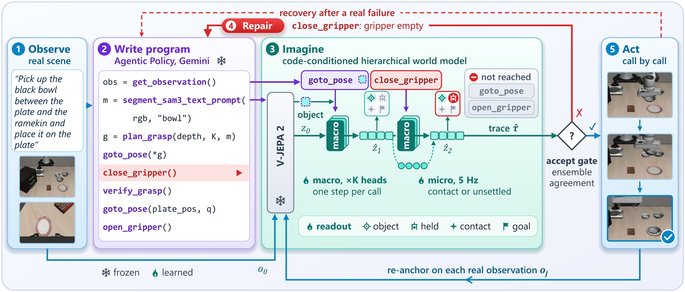

# Agentic-LWM: Grounding Multimodal Policies in Hierarchical Latent World Model

Project page: <https://physical-super-intelligence.github.io/Agentic-LWM/> (in preparation, RSS 2027).



Agentic-LWM is a dual-system framework in which a code-as-policy agent queries an action-conditioned hierarchical
joint-embedding predictive architecture (A-HJEPA) as a physics prior. A-HJEPA factorises its latent into a spatial
track and a contact track made orthogonal to it by projection, predicts contact causally from the predicted spatial
state, and is trained with a latent prediction loss plus a phase-margin loss whose failure anchors are mined from
proprioception alone. Before actuation it certifies the agent's trajectory by the predicted stability of the contact
track and, if certification fails, refines the trajectory by gradient descent on a latent energy.

## Status

The evaluation (LIBERO-PRO from perception only, Pos and Task perturbations, with an ablation ladder A0 to A3) is in
progress. The page reports no results until the runs are complete; every number added later must come from a run report.

## Page

Everything on the page follows the paper source: the overview and simulation-framework figures, the method, the
ablation ladder and hypotheses H1 to H3.

```
index.html               # the page
static/css/index.css     # styles
static/js/index.js       # nav, lightbox, BibTeX copy
static/images/           # paper figures
```

Local preview: `python3 -m http.server 8000`, then open <http://localhost:8000>.

## Citation

```bibtex
@inproceedings{sarowar2027agenticlwm,
  title     = {Agentic-LWM: Grounding Multimodal Policies in Hierarchical Latent World Model},
  author    = {Sarowar, Md Selim and Kim, Sungho},
  booktitle = {Robotics: Science and Systems (RSS)},
  year      = {2027},
  url       = {https://physical-super-intelligence.github.io/Agentic-LWM/}
}
```

## License

MIT, see [LICENSE](LICENSE).
