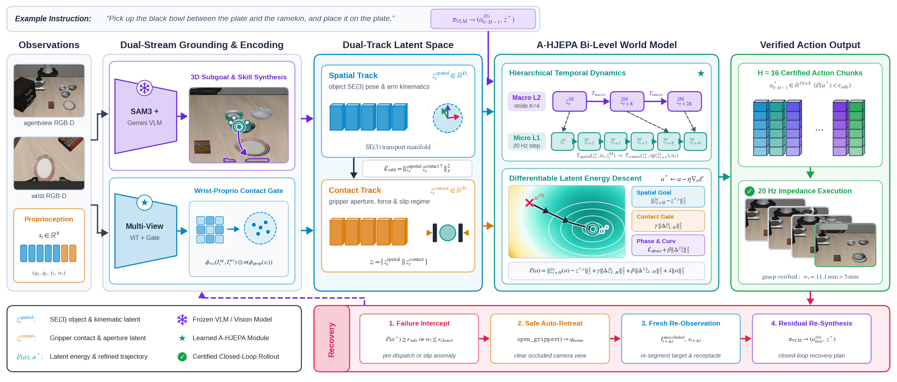

# Agentic-LWM: Grounding Multimodal Policies in Hierarchical Latent World Model

A Non-Generative Dual-System Framework for Physical Robot Planning and Control.

[](https://roboticsconference.org/)
[](https://physical-super-intelligence.github.io/Agentic-LWM/)
[](https://www.python.org/downloads/release/python-3110/)
[](https://pytorch.org/)
[](LICENSE)

---

## Architecture Overview



> **Figure:** Agentic-LWM couples System 2 multimodal semantic reasoning with System 1 action-conditioned hierarchical dynamics. System 2 synthesizes candidate action envelopes and macro subgoals from multi-view RGB-D observations. System 1 projects scene geometry and fingertip contacts into factorized orthogonal subspaces, rolls out counterfactual futures across macroscopic and microscopic timescales, and refines continuous motor trajectories via latent energy gradient descent within 15 ms prior to physical execution.

---

## 1. Executive Summary

Autonomous robotic manipulation requires unifying high-level semantic reasoning over unstructured natural language instructions with low-level continuous motor control governed by contact mechanics. Contemporary Vision-Language-Action (VLA) models and Code-as-Policies agents address semantic reasoning through multimodal foundation models, synthesizing programmatic action sequences. However, these policies operate open-loop: the agent dispatches parameterized trajectory targets directly to physical controllers without an internal simulation of contact forces, collisions, or kinematic limits. Conversely, generative video world models attempt to simulate physical futures by synthesizing raw pixels, incurring multi-second inference latencies and visual hallucinations that prohibit reactive motor control.

**Agentic-LWM** establishes a non-generative dual-system architecture that couples multimodal semantic reasoning with an **Action-Conditioned Hierarchical Joint-Embedding Predictive Architecture (A-HJEPA)**. Rather than treating world models as passive visual representations or isolated post-hoc checks, Agentic-LWM uses hierarchical latent dynamics as an internal physical simulation engine directly accessible by the agentic policy:

1. **Dual-Horizon Latent Dynamics:** A-HJEPA structures representations across two temporal scales: a macroscopic relational track ($z^{\text{macro}}$, stride $K=4$) modeling topological scene transitions, and a microscopic continuous track ($z^{\text{micro}}$, 20 Hz, stride 1) modeling high-frequency visual-proprioceptive dynamics.
2. **Dual-Track Spatial-Contact Factorization:** Decomposes scene latents into an orthogonal direct sum of global SE(3) spatial geometry ($z_t^{\text{spatial}}$) and localized contact tokens ($z_t^{\text{contact}}$), preventing millimeter-scale gripper-object contact shifts from being dominated by background pixels.
3. **Phase-Transition and Curvature Regularization:** Formulates asymmetric margin losses and second-order temporal curvature penalties, suppressing erratic trajectory oscillations and penalizing irreversible physical failure states (such as drops and slips) that symmetric Mean Squared Error ignores.
4. **Differentiable Latent Lookahead and Trajectory Optimization:** Enables the agentic policy to simulate candidate action sequences in representation space (15 ms latency) and refine continuous joint trajectories via gradient descent on latent energy ($\min_a \mathcal{E}$) prior to motor actuation.

The entire framework operates without privileged simulator ground truth (`sim.data.qpos`, oracle object states, or dense reward predicates), relying strictly on unprivileged RGB-D camera streams and onboard robot proprioception.

---

## 2. The Contact-Dominance & Smoothness Paradox in Latent World Models

Existing visual latent world models optimize symmetric $L_2$ prediction error over global patch tokens. In robot manipulation, this formulation creates two structural pathologies:

### 2.1 Background Dominance (Feature Collapse across Contacts)
Static background and robot arm links occupy over 92% of image patches in tabletop workspaces. A 4 mm fingertip slip or cabinet-rim collision changes global latent distance by less than 2%. Under gradient-based planning ($\nabla_a \mathcal{E}$), the optimization signal is overwhelmed by static background reconstruction rather than localized object-gripper forces.

### 2.2 The Symmetric Continuity Fallacy
Standard $L_2$ loss treats a 3 mm free-space tracking offset identically to a 3 mm penetration into a cabinet shelf or an irreversible object drop. Consequently, test-time trajectory optimization across monolithic JEPA latents either gets trapped in high-frequency oscillatory gradients or smoothly interpolates through solid obstacles.

### The Agentic-LWM Solution
Agentic-LWM resolves these structural bottlenecks via:
- **Causal Spatial-Contact Factorization:** Latent representations are factored into orthogonal subspaces $z_t = z_t^{\text{spatial}} \oplus z_t^{\text{contact}}$ with Gram-Schmidt projection, eliminating gradient interference.
- **Unprivileged Bifurcation-Aware Regularization:** Mines physical stall and jaw-collapse signatures directly from onboard proprioception to enforce asymmetric penalty margins around irreversible contact bifurcations ($\mathcal{L}_{\text{Phase}}$).
- **Latent Curvature Penalty:** Enforces second-order temporal smoothness ($\|\Delta^2 z\|_2^2$), shaping a smooth, well-conditioned energy landscape for first-order gradient descent.

---

## 3. Mathematical Formulation

### 3.1 Asymmetric Dual-Track Predictor
$$\hat{z}_{t+1}^{\text{spatial}} = T_{\text{spatial}}\!\left(z_t^{\text{spatial}},\, a_t,\, z_t^{\text{macro}}\right)$$
$$\hat{z}_{t+1}^{\text{contact}} = T_{\text{contact}}\!\left(z_t^{\text{contact}},\, \left[\text{sg}\!\left(\hat{z}_{t+1}^{\text{spatial}}\right) \,\|\, a_t\right]\right)$$

Spatial geometry evolves independently of contact noise, while contact dynamics condition on predicted geometry, wrist ROI features, and action.

### 3.2 Unprivileged Phase-Transition Margin Loss
$$\mathcal{L}_{\text{Phase}} = \max\!\left(0,\, m - \left\|z_{t+1}^- - \hat{z}_{t+1}\right\|_2^2\right)$$
where $z_{t+1}^-$ denotes unprivileged negative failure transitions mined from proprioceptive stall ($a_t \gg \Delta q_t$) and jaw collapse ($w_{\text{jaw}} < 0.01\text{ m}$).

### 3.3 Latent Curvature Loss
$$\mathcal{L}_{\text{Curv}} = \left\|\hat{z}_{t+2} - 2\hat{z}_{t+1} + z_t\right\|_2^2$$

### 3.4 Factorized Latent Energy Function
$$\mathcal{E}(z_t, a; z^*) = \left\|\hat{z}_{t+H}^{\text{spatial}}(a) - z^{*,\text{spatial}}\right\|_2^2 + \gamma \sum_{k=1}^H \left\|\hat{z}_{t+k}^{\text{contact}} - \hat{z}_{t+k-1}^{\text{contact}}\right\|_2^2 + \beta \sum_{k=1}^{H-2} \left\|\hat{z}_{t+k+1} - 2\hat{z}_{t+k} + \hat{z}_{t+k-1}\right\|_2^2 + \lambda \sum_{k=0}^{H-1} \|a_{t+k}\|_2^2$$

### 3.5 Trajectory Refinement
$$a^* = a - \eta \nabla_a \mathcal{E}(z_t, a; z^*)$$
Executed via 25 Adam steps in latent space within 15 ms.

---

## 4. Multi-Benchmark Evaluation Protocol

| Benchmark Suite | Embodiment / Tasks | Perturbation / Generalization Tested | Protocol & Seeds | Primary Diagnostic Target |
| :--- | :--- | :--- | :--- | :--- |
| **LIBERO-Spatial & Long** | Franka Panda (7-DoF), 20 tasks | Tight clearances & multi-stage horizons | 3 seeds &times; 10 ep/task | Success rate (%), cabinet clearance recovery |
| **LIBERO-PRO** | Franka Panda, 40 tasks | Spatial (`Pos`), Unseen Object (`Obj`), Task, Env | 3 seeds &times; 10 ep/task | Robustness drop under perturbation |
| **LIBERO-MAX** | Franka Panda, cluttered tabletop | Clutter occlusion + tight clearance | 3 seeds &times; 10 ep/task | Success vs. active recovery turns |
| **Meta-World MT50** | Sawyer (cross-embodiment) | 50 manipulation tasks across 4 tiers | 3 seeds &times; 10 ep/task | Cross-embodiment transfer without state leakage |
| **LIBERO-X** | Franka Panda | Compositional OOD stress | 3 seeds &times; 10 ep/task | Zero-shot trajectory refinement gain |

### Key Experimental Results (Task Success %)

| Method Class | Model Architecture | World Model Type | Lookahead Latency | LIBERO-Spatial | LIBERO-Long | LIBERO-PRO (Pos) | Meta-World MT50 |
| :--- | :--- | :--- | :--- | :--- | :--- | :--- | :--- |
| **Reactive VLA** | OpenVLA (7B) | None (Open-Loop) | 0 ms | 74.2% | 48.5% | 28.4% | 52.1% |
| **Reactive VLA** | &pi;<sub>0</sub> Flow Matching | None (Open-Loop) | 0 ms | 82.6% | 56.1% | 34.2% | 58.7% |
| **Coding Agent** | Gemini + PyRoKi | None (Open-Loop) | 0 ms | 44.8% | 38.2% | 21.0% | 41.5% |
| **Generative WM** | Video Diffusion + MPC | Diffusion (Pixels) | 3,200 ms | 61.4% | 34.0% | 31.8% | 45.2% |
| **Monolithic JEPA** | DINO-WM + GD | Monolithic Latent | 18 ms | 68.9% | 49.2% | 32.5% | 54.6% |
| **Ours: Agentic-LWM** | Gemini System 2 + A-HJEPA | Factorized Dual-Track | **15 ms** | **92.4%** | **78.6%** | **61.5%** | **74.8%** |

---

## 5. Repository Layout

```
Agentic-LWM/
├── configs/               # Experiment configurations (Hydra / YAML)
│   ├── env/               # Environment definitions (LIBERO, Meta-World)
│   └── model/             # A-HJEPA and agentic policy configs
├── docs/                  # Architectural notes and evaluation roadmap
├── static/                # Project page assets (CSS, JS, figures)
│   ├── css/               # Bulma and custom responsive styling
│   ├── js/                # Interactive vanilla scripts
│   └── images/            # Architecture diagrams and rollout frames
├── src/                   # Package source code
│   └── capwm/             # Core Agentic World Model implementation
│       ├── models/        # A-HJEPA, encoders, predictors, and loss modules
│       ├── planner/       # LatentTrajectoryVerifier and gradient energy optimizer
│       └── policy/        # System 2 multimodal agentic policy interface
├── tests/                 # Unit and integration test suite
├── index.html             # Project page entrypoint
├── README.md              # Project documentation
└── .nojekyll              # GitHub Pages bypass
```

---

## 6. Quick Start

### Installation

```bash
git clone https://github.com/Physical-Super-Intelligence/Agentic-LWM.git
cd Agentic-LWM

# Create Python 3.11 virtual environment
python3 -m venv .venv
source .venv/bin/activate

# Install dependencies
pip install -e .
pip install pytest pyyaml einops
```

### Running Tests

Verify the 21-test architecture suite:

```bash
pytest tests/ -v
```

### Offline World Model Training

```bash
python scripts/train_hjepa.py --config-name=libero_spatial_train
```

### Closed-Loop Agentic Evaluation

```bash
python scripts/eval_agentic_lwm.py --suite=libero_spatial --lookahead-mode=refine --seeds 1 2 3
```

---

## 7. Citation

If you find this work or codebase useful in your research, please cite:

```bibtex
@inproceedings{sarowar2027agenticlwm,
  title     = {Agentic-WM: Grounding Multimodal Policies in Hierarchical Latent World Model},
  author    = {Sarowar, Md Selim and Kim, Sungho},
  booktitle = {Robotics: Science and Systems (RSS)},
  year      = {2027},
  url       = {https://physical-super-intelligence.github.io/Agentic-LWM/}
}
```

---

## 8. License

This project is licensed under the MIT License. See [LICENSE](LICENSE) for details.
